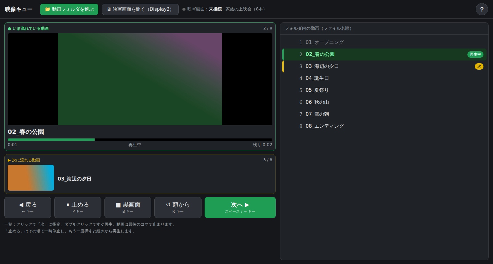

# 映像キュー（video-cue-player）

フォルダに入れた動画を、**キーを押すたびに1本ずつ**、2台目の画面（プロジェクターやテレビ）へ映すためのソフトです。
朗読会や発表会で「場面に合わせて映像を出す」係の人のために作りました。家族の動画をテレビに映して、みんなで見るときにも使えます。

## 特長

- **インストール不要**：`index.html` をブラウザ（Edge、Chrome、Brave）で開くだけで動きます。
- **ネット接続不要**：動画はパソコンの中だけで読み込まれ、どこにも送信されません。
- **手元とスクリーンを分けて表示**：手元の画面（Display1）で操作し、スクリーン（Display2）には映像だけが映ります。
- **今と次が一目で分かる**：再生中の動画は緑、次の動画は黄色で一覧に表示されます。
- **最後のコマで止まる**：動画が終わると最後のコマで静止し、次の合図を待ちます。
- **途切れない切り替え**：次の動画を裏で先に読み込んでおくので、切り替えのときに黒いすき間が出ません。

## 使い方

1. 動画を1つのフォルダに入れ、再生したい順に名前の頭へ番号を付けます（例：`01_オープニング.mp4`、`02_春の公園.mp4`）。
2. パソコンにテレビやプロジェクターをつなぎ、`Windows キー + P` で **「拡張」** を選びます。
3. `index.html` をブラウザで開き、「📁 動画フォルダを選ぶ」でフォルダを選びます。
4. 「🖥 映写画面を開く」を押すと、黒い窓が開きます。ポップアップがブロックされたら「常に許可」を選んで、もう一度押してください。
5. 黒い窓をテレビ側へ移します（窓をクリックして `Windows キー + Shift + →`、またはドラッグ）。
6. テレビ側で黒い窓を **ダブルクリック**（または F11）すると全画面になります。
7. 手元の操作画面をクリックしてから、スペースキーで再生を始めます。

## キー操作

| ボタン | キー | 動き |
| --- | --- | --- |
| 次へ ▶ | スペース / → | 次の動画を再生 |
| ◀ 戻る | ← | 前の動画を頭から再生 |
| ⏸ 止める | P（Enter でも可） | その場で一時停止し、もう一度押すと続きから再生 |
| ■ 黒画面 | B | スクリーンを真っ黒にし、もう一度押すと元に戻る |
| ↺ 頭から | R | 今の動画を最初から再生 |
| ？ | H | 使い方を表示（Esc で閉じる） |

一覧の動画をクリックするとその動画が「次」になり、ダブルクリックするとすぐ再生されます。

## 本番前のおすすめ設定（Windows）

- **通知を止める**：「設定 → システム → 通知」で「応答不可」をオンにします。
- **画面を暗くしない**：「設定 → システム → 電源」で、画面の電源を切るまでの時間とスリープまでの時間を「なし」にします。

## 対応している動画

mp4 / m4v / mov / webm（ブラウザが再生できる形式）。音声は再生しません（無音で映します）。

## ライセンス

[MIT License](LICENSE)
